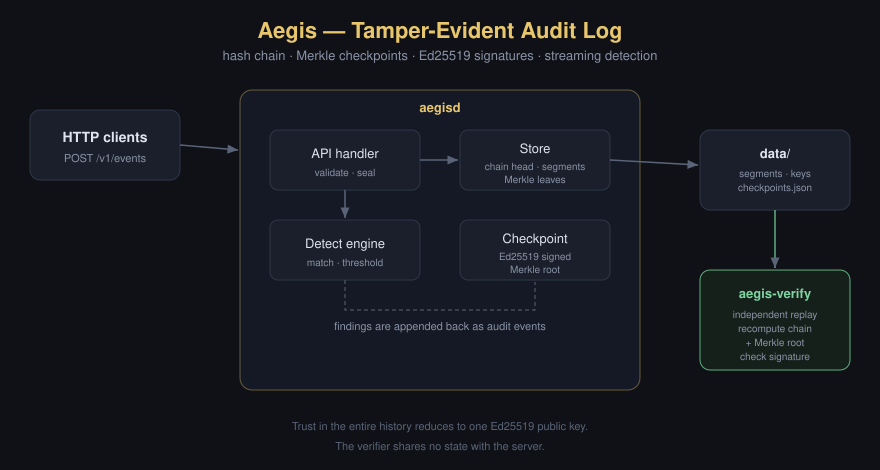

# Aegis

**A tamper-evident audit log and streaming threat-detection engine, written in Go with zero external dependencies.**

Aegis is an append-only event log where every record is cryptographically chained to the one before it, batched into Merkle trees, and committed under Ed25519-signed checkpoints. Any attempt to modify, delete, reorder, or insert a historical event is detected, and the verifier reports the exact sequence number where integrity broke. A streaming rules engine evaluates every event as it arrives and writes its findings back into the same tamper-evident log.

This is the kind of integrity substrate that sits underneath SIEM pipelines, financial ledgers, and compliance evidence stores (SOC 2 CC7, ISO 27001 A.12.4, NIST SP 800-92).

---

## Why this is interesting

Most audit logs are trustworthy only if you also trust the database, the operator, and the backups. Aegis removes that assumption. The integrity of the entire history reduces to one public key. An auditor who holds that key can prove, offline and independently, that not a single byte was changed since a checkpoint was signed, without trusting the server that produced it.

The design borrows from production systems: hash chaining as in Git and blockchains, Merkle inclusion proofs as in Certificate Transparency (RFC 6962) and Sigstore Rekor, and segmented append-only storage as in Kafka and write-ahead logs.

---

## Guarantees

| Property | Mechanism | Caught by |
| --- | --- | --- |
| A field of a record was modified | SHA-256 hash recomputation | `VerifyChain`, on-disk replay |
| A record was deleted or reordered | `prev_hash` linkage + strict sequence | `VerifyChain` |
| A record was inserted into history | broken `prev_hash` of the next event | `VerifyChain` |
| The whole log was replaced | Ed25519 signature over the Merkle root | checkpoint signature check |
| "Is event N really in the signed history?" | Merkle inclusion proof | offline proof verification |
| Security-relevant patterns (brute force, exfiltration, privilege escalation) | streaming rules engine | detection findings, themselves logged |

---

## Architecture



```
                 ┌───────────────────────────────────────────────┐
   HTTP clients  │                  aegisd                       │
  ───────────►   │                                               │
  POST /v1/events│   ┌─────────┐   seal     ┌──────────────────┐ │
                 │   │  API    ├───────────►│  Store           │ │
                 │   │ handler │            │  hash-chain head │ │
                 │   └────┬────┘            │  segmented files │ │
                 │        │                 │  Merkle leaves   │ │
                 │        ▼                 └────────┬─────────┘ │
                 │   ┌──────────┐                    │           │
                 │   │ Detect   │  findings as       │ checkpoint│
                 │   │ engine   │  audit events ─────┘ (Ed25519) │
                 │   └──────────┘                                │
                 └───────────────────────┬─────────────────────-─┘
                                         │ data/ (segments, keys, checkpoints)
                                         ▼
                          ┌───────────────────────────────┐
                          │  aegis-verify (independent)   │
                          │  replays from disk, recomputes│
                          │  chain + Merkle root, checks  │
                          │  signature with public key    │
                          └───────────────────────────────┘
```

See [ARCHITECTURE.md](ARCHITECTURE.md) for the data model, on-disk format, and the full threat model.

---

## Quick start

Requires Go 1.22+. No third-party modules.

```bash
make build           # builds bin/aegisd and bin/aegis-verify
make run             # starts the server on :8080 with data in ./data

# In another shell:
make demo            # ingests events, triggers detection, checkpoints,
                     # proves inclusion, then simulates an attacker
                     # tampering with disk and shows it being caught
```

Manual walkthrough:

```bash
# 1. Log an event
curl -X POST localhost:8080/v1/events \
  -d '{"actor":"alice","action":"object.read","resource":"doc/42","outcome":"success","source":"app"}'
# -> {"seq":0,"hash":"...","prev_hash":"AAAA...="}

# 2. Trip the brute-force rule (6 failed logins for one actor in 60s)
for i in $(seq 1 6); do
  curl -s -X POST localhost:8080/v1/events \
    -d '{"actor":"mallory","action":"auth.login","outcome":"failure","source":"sshd"}'
done
curl localhost:8080/v1/alerts

# 3. Issue a signed checkpoint and prove event 0 is in it
curl -X POST localhost:8080/v1/checkpoint
curl localhost:8080/v1/proof/0

# 4. Independently audit the log from disk (shares no state with the server)
bin/aegis-verify -data ./data -seq 0
```

---

## HTTP API

| Method | Path | Purpose |
| --- | --- | --- |
| `POST` | `/v1/events` | Ingest an event; runs detection; returns sealed receipt |
| `GET` | `/v1/events/{seq}` | Fetch one event |
| `GET` | `/v1/events?from=&to=` | Range scan |
| `POST` | `/v1/checkpoint` | Issue an Ed25519-signed Merkle checkpoint |
| `GET` | `/v1/checkpoint/latest` | Latest signed checkpoint |
| `GET` | `/v1/proof/{seq}` | Merkle inclusion proof against the latest checkpoint |
| `GET` | `/v1/verify` | Server-side full replay and chain verification |
| `GET` | `/v1/alerts` | Detection findings |
| `GET` | `/healthz` | Liveness and event count |

A Go SDK is in [`pkg/client`](pkg/client/client.go).

---

## Detection rules

Rules are JSON and hot-swappable via `-rules`. Two kinds:

- **Match rules** fire on a single event (for example, any `control.disable`).
- **Threshold rules** fire when more than `threshold` matching events share the same `group_by` value within a rolling `window_seconds` (for example, brute-force authentication).

Findings are converted into audit events and appended to the same log, so the record of what the detector observed is as immutable as the events that triggered it. See [configs/rules.json](configs/rules.json).

---

## Testing

```bash
make test            # unit + adversarial tests, race detector on
make cover           # coverage report
```

The suite includes adversarial tests that mutate, delete, reorder, and forge records (including editing a persisted segment file directly on disk) and assert that verification fails at the correct sequence. Core packages run 73 to 95 percent statement coverage.

---

## Engineering notes and honest tradeoffs

- Merkle leaves are held in memory for fast checkpointing. This bounds a single node's history to available RAM. The production path is sharded checkpoints over segment ranges (a Merkle forest); the segment format already supports it.
- `fsync` is called on every append so an event is durable before the writer is acknowledged. This caps single-writer throughput; batched group-commit is the standard next step and is noted in the code.
- The signing key is generated and stored locally for a self-contained demo. In production this is a KMS or HSM; the `keys` package isolates that boundary behind one interface.
- This is a from-scratch systems exercise, not a certified cryptographic product. The primitives (SHA-256, Ed25519, RFC 6962 domain separation) are standard library and standard construction; the threat model is documented rather than assumed.

---

## License

MIT. See [LICENSE](LICENSE).
